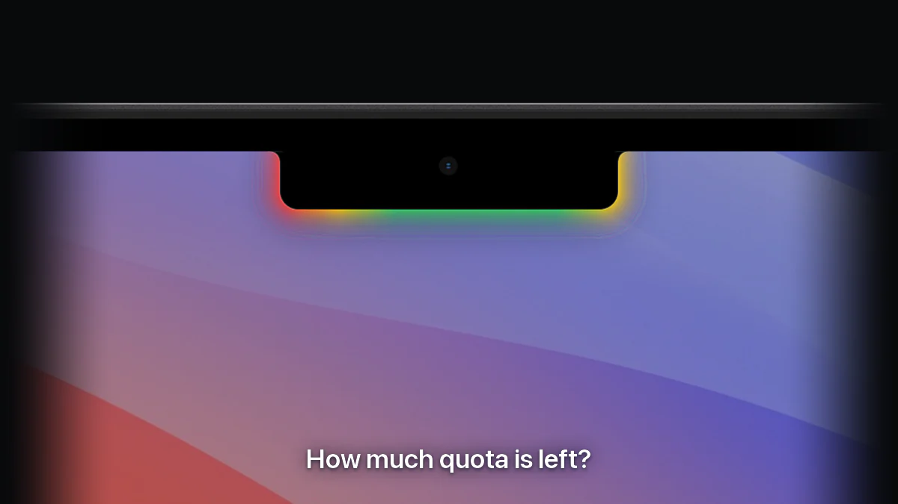
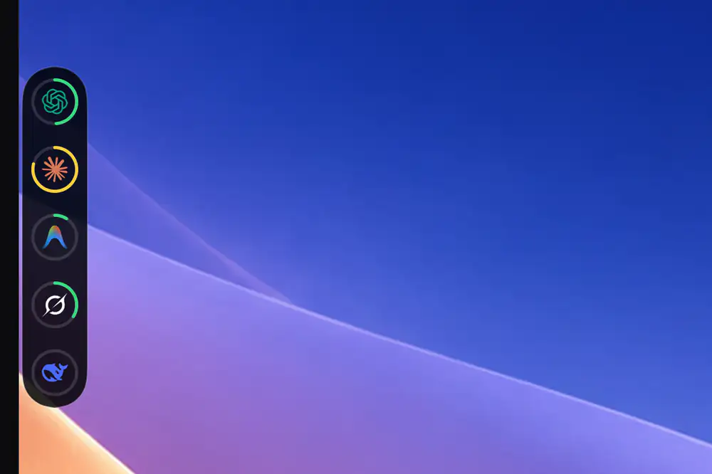

<h1 align="center">Agent HUD</h1>
<p align="center"><strong>English</strong> · <a href="README.zh-CN.md">简体中文</a></p>
<p align="center">
  <strong>Your agents, at a glance.</strong><br>
  Usage, tokens and sessions for Claude Code, Codex and 15 more agents, at your Mac's notch or on any screen edge.
</p>

<p align="center">
  <a href="https://agenthud.app/mac"></a>
  <a href="https://apps.apple.com/app/id6812113619"></a>
  <a href="#build-from-source"></a>
</p>

<p align="center">
  <a href="https://agenthud.app">Website</a> ·
  <a href="#at-a-glance-or-a-hover">At a glance</a> ·
  <a href="#approvals-questions-and-replies-in-one-place">Approvals</a> ·
  <a href="#where-the-tokens-go">Statistics</a> ·
  <a href="#on-your-iphone">iPhone</a> ·
  <a href="#supported-clients">Supported clients</a> ·
  <a href="#documentation">Documentation</a><br>
  <a href="#build-from-source"></a> <a href="Package.swift"></a> <a href="LICENSE"></a>
</p>

<p align="center">
  
</p>

Agent HUD keeps your coding agents in view while you work in another app. It sits at your Mac's notch, and on every display you connect, and answers the questions you would otherwise switch windows for:

- **How much quota is left?** The glow turns green, yellow or red as a quota fills. Hover for every quota and its reset time, the last 24 hours of tokens, and your sessions.
- **Which agent is waiting for you?** Permission requests, questions and replies arrive in one place, and where the client supports it, one click takes you back to the session.
- **Where did the tokens go?** A statistics window breaks them down by time, agent and model, then by session and turn, and shows what they would have cost at API prices.
- **Away from your Mac?** The iPhone app shows the same numbers. With Agent HUD Remote they follow you to any network, along with conversations to read and, as an experimental option, a way to answer your agents.

**Everything on the Mac is free**, with no account and no API key. This repository is the app's open-source core, and a build from it has every Mac feature below. The [official app](https://agenthud.app/mac) is that core plus the connection to your iPhone, and viewing your Mac's quotas, tokens and sessions from an iPhone on the same network is free too. One feature is paid: [Agent HUD Remote](#on-your-iphone), which carries all of this beyond that network and puts conversations, alerts and answers on the phone.

## At a glance, or a hover

The glow around the notch is the reading. Each quota window, such as a 5-hour or weekly limit, is one colour segment: green under 70% used, yellow from 70%, red from 90%. The glow moves faster while an agent is working.

Hover, and the panel opens with the numbers:

- **Quotas**: every window's share used and its reset countdown. Switch to burn rate to see when a window will run out at the current pace.
- **Tokens**: the last 24 hours in 15-minute bars.
- **Sessions**: up to five, those waiting for you first.
- **Balances**: prepaid balances and credits, where a client has them.

**You are warned before a quota runs out**: at 90% used, or sooner if the burn rate says it will not last until the reset. Another reminder follows when it runs out, and one when it resets.

Agent HUD reads the records your clients already keep on your Mac, and asks each vendor's own service for quota with the client's existing sign-in. No read sends a message to a model. What each client reports [varies](#supported-clients).

## At the notch, and on every display

On a MacBook with a notch, Agent HUD lives at the notch. A display without one, such as an external monitor, gets a HUD of its own: a row of agent logos you can drag to any screen edge. Each display keeps its own [mode](#bots-modes-and-settings), position, size and glow, and a reminder shows once, on the display your pointer is on.

<p align="center">
  <br>
  <sub>Simple mode on a display's left edge, with Separate agents on · Sample data</sub>
</p>

## Approvals, questions and replies in one place

When an agent needs you, its request waits on the HUD with the command, file, edit diff or tool input it is asking about. Answer there, without switching windows.

<p align="center">
  
</p>

- **Approvals.** Answer **Deny** or **Allow once**. **Always allow** appears where the client offers a rule, and the rule is written out first.
- **Questions.** Pick an option, several where allowed, or type your own.
- **Replies.** When a turn finishes, a **New reply** reminder names the agent and its session or project.
- **One click back.** Click a session's title, or **Return to session** on a reply, and you are in that session: its thread or tab in the desktop app, or the iTerm2 pane it runs in. Where a client gives no way back, the title opens the session's page in Agent HUD.

<sub>Approvals: Claude Code, Codex (once you trust its hook in Codex), Antigravity, ZCode, CodeBuddy, WorkBuddy, Qwen Code and the Qoder builds. Questions: Claude Code, Codex Desktop, ZCode and compatible DeepSeek Harness hosts. Replies: 13 of the 17 clients. One click back: Codex, Claude Code, Antigravity, Grok CLI, Grok Bot, Pi and OpenCode. Details in [HUD and approvals](docs/hud.md#approvals), [session navigation](docs/session-navigation.md) and [provider support](docs/providers.md).</sub>

Agent HUD never answers for you: a request you leave alone goes back to the client's own prompt after 10 minutes, or the wait you set. To receive requests it adds a handler to each detected client's own settings; one switch, **Client hooks** in Settings → General, removes them all.

## Where the tokens go

The statistics window keeps 30 days of token history on your Mac.

<p align="center">
  <a href="docs/screenshots/usage-statistics.webp"></a> <a href="docs/screenshots/mac-session.webp"></a><br>
  <sub>The Tokens page and a session's page of the statistics window · Sample data</sub>
</p>

- **By time.** The last 5 hours, 24 hours, 7 days or 30 days, in bars as fine as 15 minutes. Hover a bar for that period by model.
- **By agent and model.** One card per agent with its share, top models and top sessions. Narrow the chart to any set of models and any of five token kinds: Input, Output, Reasoning, Cache write and Cache read.
- **By session, turn and call.** Open a session from the last 7 days to see tokens per turn and how full its context window got, then click a turn to see every model call in it. Turn-by-turn views cover Claude Code, Codex and DeepSeek Harness.
- **Sub-agents and cache.** For Claude Code and Codex, sub-agent tokens count into their parent session and show as their own part of each turn. Cache hit rates are given per period, per session and per model.
- **What it is worth.** Every level, down to a single call, is also priced at the vendor's published API prices, where a model has one, and marked ≈. On a subscription, that is what the same usage would have cost through the API: an estimate, not a charge.

## On your iPhone

Agent HUD for iPhone and Apple Watch shows what your Mac collects: quotas, balances, token statistics and each session's tokens by turn. The app is free.

<p align="center">
  <a href="docs/screenshots/iphone-home.webp"></a> <a href="docs/screenshots/iphone-sessions.webp"></a><br>
  <sub>Agent HUD for iPhone · Home and Sessions · Sample data</sub>
</p>

**On the same network, viewing is free.** In the official Mac app, turn on Settings → Local network → **Share this Mac**. An iPhone on the same Apple Account connects by itself; any other iPhone pairs by scanning a QR code. The Mac serves the phone directly, with no subscription and no Agent HUD server.

**Agent HUD Remote is for when you are away from your Mac.** It syncs through your own iCloud and adds:

- **Your Macs anywhere**: on iPhone, in widgets and on Apple Watch, whatever network you are on.
- **Conversations**: the prompts and replies of Claude Code, Codex, Grok CLI, Grok Bot and Antigravity sessions, to read on the phone.
- **Remote Sessions** (experimental): allow or deny a tool call and message Claude Code and Codex sessions from the phone, even mid-turn. Off until you turn it on in the Mac's Settings → Experimental; the [guide](https://agenthud.app/guides/remote-sessions) says what each agent takes.
- **Alerts** on iPhone and Apple Watch, and Live Activities on the Lock Screen and in the Dynamic Island.

Conversations, Remote Sessions, alerts and Live Activities need Agent HUD Remote even on the same network as the Mac. It is a subscription counted by Macs (1, 2 or 3), monthly or yearly, with the first week free: start it in the iPhone app, where the price is shown, then turn on **Enable this Mac** in the Mac's Settings → Subscription. iPhone and Apple Watch never count.

<sub>Needs Agent HUD for Mac 0.5.0 and Agent HUD for iPhone 1.5, or later; Remote Sessions needs Mac 0.5.1 and iPhone 1.6. Agent HUD Remote needs the same Apple Account on Mac and iPhone. The official Mac app is for Apple silicon.</sub>

## Bots, modes and settings

**Bots.** Every agent's logo has a small bot in the logo's own shape and colours, with eyes that follow your pointer. In Dynamic mode the logo becomes its bot while the agent works. On a reminder, in any mode, it hops when the agent needs your approval and smiles when a turn is done. [See every agent's bot](docs/videos/agent-bots.gif).

**Modes.** Each display runs one of three:

| Mode | On screen |
| --- | --- |
| **Notch** | The island at the notch, with the glow around it. |
| **Simple** | A small floating panel on any screen edge: each agent's logo in a ring of its most used quota window, with the percentage beside it. |
| **Dynamic** | A row of agent logos on any screen edge, with the glow behind them. |

**Settings.** Choose which accounts and quota windows are shown, each display's mode, size and glow (six styles, six effects), what the panel contains and how quickly it opens. The app runs in English or Simplified Chinese. **⌘⌥H** hides or shows the glow; while it is hidden, only requests still appear.

## Supported clients

**Claude Code** · **Codex Desktop / CLI** · **DeepSeek Harness** · **Antigravity** · **Cursor** · **Grok CLI** · **Grok Bot** · **GitHub Copilot CLI** · **OpenCode** · **Kimi** · **Pi** · **OpenClaw** · **Hermes Agent** · **ZCode** · **CodeBuddy** · **WorkBuddy** · **Qwen Code**

Install and sign in to the clients you want to monitor. Coverage varies by client and account. All 17 report tokens and sessions; 10 report a plan quota (Claude Code, Codex, Antigravity, Cursor, Grok CLI, Grok Bot, GitHub Copilot CLI once you allow it, OpenCode with OpenCode Go, Kimi, and Pi through the plans it is signed in to); 8 show live running status, which is what speeds up the glow. Several accounts of one client are kept apart, each with its own section. See [provider support](docs/providers.md) for each client.

**GLM Coding Plan** is not a client: its quota is read, and its tokens are counted under the client that used it. The **Qoder** builds (Qoder, Qoder CN, QoderWork) get approvals on the HUD and nothing else.

### Your data

Local monitoring reads the clients' records on your Mac. Quota and balance figures, and Cursor's usage, come from each vendor's own service, read with the installed client's existing sign-in or configured credentials; those credentials stay out of reports and stored usage data. Usage history is kept in a local database. A build from this source uploads nothing; what the official app shares with your iPhone or through your iCloud is set out in its [privacy policy](https://agenthud.app/privacy). See also [data access](docs/data-access.md).

## Build from source

**Requirements:** macOS 14+ and Xcode or the Xcode Command Line Tools with a Swift 6 toolchain.

```sh
git clone https://github.com/jazzenchen/agent-hud-open.git
cd agent-hud-open
make check
make test
make run
```

This builds and opens `build/Agent HUD Open.app`, signed ad-hoc for local use. No developer account, signing identity or provisioning profile is required. To try the app without any clients, quit it and run `make demo`, which opens it on sample data.

<details>
<summary><strong>Development and embedding</strong></summary>

| Command | Purpose |
| --- | --- |
| `make check` / `make test` | Check source boundaries / run unit tests |
| `make build` / `make run` | Build the locally signed app / build and open it |
| `make demo` / `make snapshot` | Open sample data / render the UI to `build/snapshots` |

The Swift package exposes `AgentHUDSupport` (records and identities), `AgentHUDCore` (providers, models and storage), and `AgentHUDDesktop` (native HUD and statistics). `AgentHUDOpen` is the standalone executable. Hosts can provide settings pages and services through `DesktopApplication`; see [host integration](docs/architecture.md#host-integration).

CI checks source boundaries, runs unit tests, builds the app and verifies its signature and resources.

</details>

## Documentation

[HUD and approvals](docs/hud.md) · [Providers](docs/providers.md) · [Usage semantics](docs/usage-semantics.md) · [Session lifecycle](docs/session-lifecycle.md) · [Session navigation](docs/session-navigation.md) · [Data access](docs/data-access.md) · [Architecture](docs/architecture.md) · [Performance](docs/performance.md) · [Command line](docs/command-line.md) · [Updates](docs/updates.md) · [Brand assets](docs/brand-assets.md) · [Changelog](CHANGELOG.md)

## License

[Apache-2.0](LICENSE). Provider references and icon assets retain their [third-party notices](THIRD_PARTY_NOTICES.txt) and [icon license](Sources/AgentHUDDesktop/Resources/LobeIcons-LICENSE.txt).
