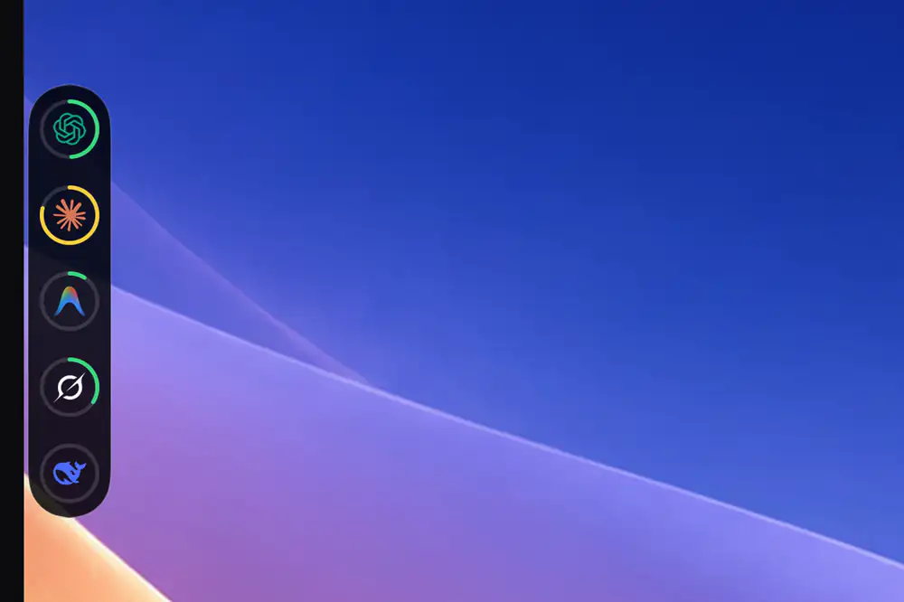
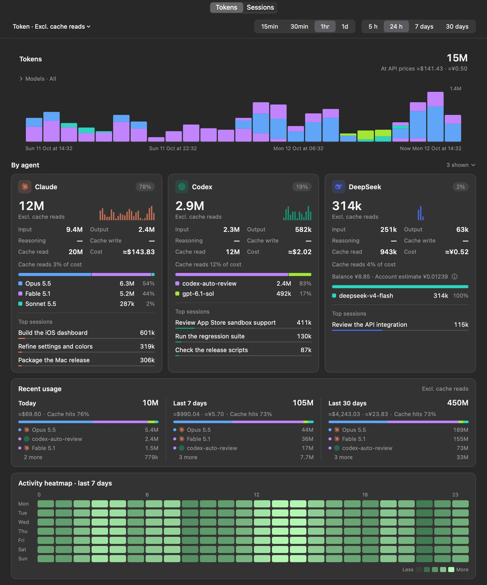
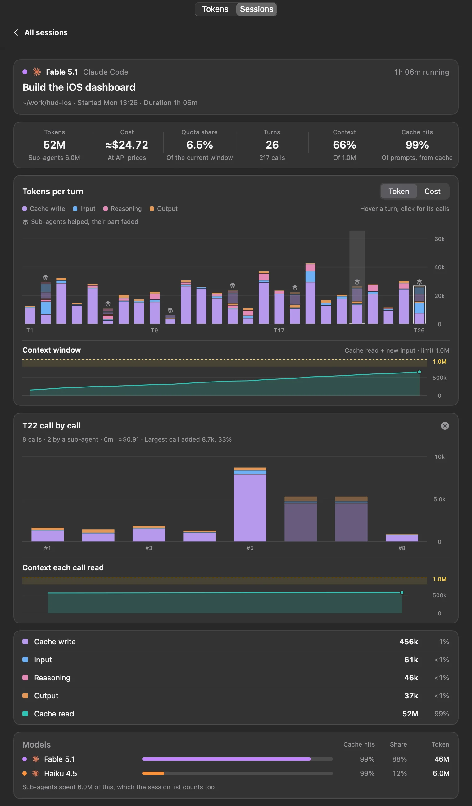
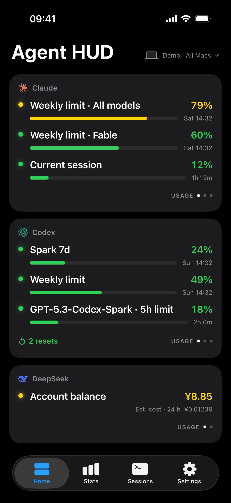
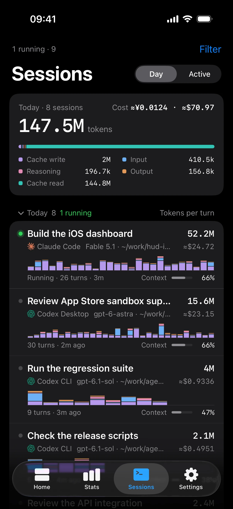

<h1 align="center">Agent HUD</h1>
<p align="center"><a href="README.md">English</a> · <strong>简体中文</strong></p>
<p align="center">
  <strong>你的 Agent，抬眼可见。</strong><br>
  Claude Code、Codex 以及另外 15 款 agent 的用量、Token 与会话，就在 Mac 灵动岛或任意屏幕边缘。
</p>

<p align="center">
  <a href="https://agenthud.app/mac"></a>
  <a href="https://apps.apple.com/cn/app/agent-hud/id6812113619?uo=4"></a>
  <a href="#从源码构建"></a>
</p>

<p align="center">
  <a href="https://agenthud.app">官网</a> ·
  <a href="#看一眼或悬停一下">抬眼可见</a> ·
  <a href="#批准提问与回复集中一处">批准</a> ·
  <a href="#token-花在了哪里">统计</a> ·
  <a href="#在-iphone-上">iPhone</a> ·
  <a href="#支持的客户端">支持的客户端</a> ·
  <a href="#文档">文档</a><br>
  <a href="#从源码构建"></a> <a href="Package.swift"></a> <a href="LICENSE"></a>
</p>

<p align="center">
  
</p>

Agent HUD 让你在使用其他应用时，也能看到各个编程 agent 的状态。它常驻 Mac 灵动岛，也出现在你接入的每块屏幕上，替你回答那些原本要切换窗口才能知道的事：

- **额度还剩多少？** 光晕随额度用量变为绿、黄、红。悬停即可看到每项额度和重置时间、过去 24 小时的 Token，以及你的会话。
- **哪个 agent 在等你？** 批准请求、提问与回复集中在一处；客户端支持时，点一下就回到对应的会话。
- **Token 花在了哪里？** 统计窗口按时间、agent 与模型拆解，再细到每个会话、每一轮，并给出按 API 价折合的费用。
- **离开 Mac 之后呢？** iPhone App 显示同样的数字。有了 Agent HUD Remote，换到任何网络都能看到，还能阅读对话，并以实验功能的形式回应你的 agent。

**Mac 上的功能全部免费**，无需账户，也无需 API Key。本仓库是这款应用的开源核心，从它构建的应用包含下文所有 Mac 功能。[官方应用](https://agenthud.app/mac)在这个核心之上增加了与 iPhone 的连接；在同一局域网内用 iPhone 查看这台 Mac 的额度、Token 与会话，同样免费。唯一的付费功能是 [Agent HUD Remote](#在-iphone-上)：它把这些带到局域网之外，并把对话、提醒与回应放到手机上。

## 看一眼，或悬停一下

灵动岛周围的光晕就是读数。每个额度窗口（例如 5 小时或每周额度）对应一段颜色：已用不足 70% 为绿色，达到 70% 为黄色，达到 90% 为红色。有 agent 在工作时，光晕动得更快。

悬停后，面板展开，给出具体数字：

- **额度**：每个窗口的已用比例与重置倒计时。切换到消耗速率，可看到按当前速度何时耗尽。
- **Token**：过去 24 小时的用量，每 15 分钟一根柱。
- **会话**：最多五个，等你处理的排在最前。
- **余额**：预付余额与额度重置次数，视客户端而定。

**额度耗尽前会提醒你**：用到 90% 时，或按消耗速率预计撑不到重置时，以先到者为准。耗尽时、完成重置时各再提醒一次。

Agent HUD 读取各客户端已经保存在这台 Mac 上的记录，并用客户端现有的登录状态向各厂商自己的服务查询额度。任何一次读取都不会向模型发送消息。各客户端能提供的信息[有所不同](#支持的客户端)。

## 在灵动岛，也在每块屏幕上

在带灵动岛的 MacBook 上，Agent HUD 常驻灵动岛。没有灵动岛的屏幕（例如外接显示器）也有自己的 HUD：一排 agent 图标，可以拖到任意一条屏幕边缘。每块屏幕各自保存[形态](#bot形态与设置)、位置、大小与光晕；提醒只出现一次，出现在指针所在的那块屏幕上。

<p align="center">
  <br>
  <sub>停靠在屏幕左侧的简约形态，已开启「按 agent 分开」 · 示例数据</sub>
</p>

## 批准、提问与回复，集中一处

有 agent 需要你时，请求会停在 HUD 上，并附上所涉及的命令、文件、编辑差异或工具输入。不必切换窗口，直接在这里回答。

<p align="center">
  
</p>

- **批准**：可选**拒绝**或**批准一次**。客户端提供规则时才出现**总是允许**，并会先写出这条规则。
- **提问**：选一个选项，可多选时选几个，或者自己输入。
- **回复**：一轮结束时，**有新回复**提醒会写明是哪个 agent 的哪个会话或项目。
- **一键回到会话**：点击会话标题，或回复提醒上的**回到会话**，即可回到那个会话：桌面应用里它的线程或标签页，或它所在的 iTerm2 窗格。客户端没有提供返回位置时，点击标题会打开 Agent HUD 里的会话页。

<sub>批准：Claude Code、Codex（需先在 Codex 中信任该回调）、Antigravity、ZCode、CodeBuddy、WorkBuddy、Qwen Code 与 Qoder 系列。提问：Claude Code、Codex Desktop、ZCode 与兼容的 DeepSeek Harness 宿主。回复：17 款客户端中的 13 款。回到会话：Codex、Claude Code、Antigravity、Grok CLI、Grok Bot、Pi 与 OpenCode。详见 [HUD 与批准](docs/hud.md#approvals)、[会话跳转](docs/session-navigation.md)与[数据源支持](docs/providers.md)。</sub>

Agent HUD 从不替你回答：你没有处理的请求，默认 10 分钟后交还客户端，由它自己询问，等待时长可以调整。为了接收请求，它会在检测到的各客户端的设置里写入回调；用「设置 → 通用」里的**客户端回调**开关可一并移除。

## Token 花在了哪里

统计窗口在这台 Mac 上保留 30 天的 Token 历史。

<p align="center">
  <a href="docs/screenshots/usage-statistics.webp"></a> <a href="docs/screenshots/mac-session.webp"></a><br>
  <sub>统计窗口的 Token 页与会话详情页 · 示例数据</sub>
</p>

- **按时间**：过去 5 小时、24 小时、7 天或 30 天，每根柱最细到 15 分钟。悬停在某根柱上，可看到该时段各模型的用量。
- **按 agent 与模型**：每个 agent 一张卡片，列出它的占比、用量最多的模型与会话。图表可筛选任意模型组合，以及五类 Token 中的任意几类：输入、输出、推理、缓存写入、缓存读取。
- **按会话、轮次与调用**：打开最近 7 天内的任一会话，查看每轮的 Token 以及上下文窗口用了多少；点击某一轮，可看到其中每一次模型调用。逐轮视图支持 Claude Code、Codex 与 DeepSeek Harness。
- **子 agent 与缓存**：在 Claude Code 与 Codex 中，子 agent 的 Token 计入所属会话，并在每一轮中单独标出。缓存命中率按时段、会话和模型分别给出。
- **折合多少钱**：每一层，直到单次调用，都按厂商公开的 API 价折合成费用（没有公开价的模型不计），并标 ≈。对订阅用户来说，这就是同样的用量走 API 要花的钱：是估算，不是实际扣费。

## 在 iPhone 上

iPhone 与 Apple Watch 版 Agent HUD 显示 Mac 采集到的数据：额度、余额、Token 统计，以及每个会话逐轮的 Token。App 免费。

<p align="center">
  <a href="docs/screenshots/iphone-home.webp"></a> <a href="docs/screenshots/iphone-sessions.webp"></a><br>
  <sub>iPhone 版 Agent HUD · 首页与会话 · 示例数据</sub>
</p>

**同一局域网内，查看免费。** 在官方 Mac 版中打开「设置 → 局域网 → **分享此 Mac**」。登录同一 Apple 账户的 iPhone 会自动连接，其他 iPhone 扫描二维码即可配对。Mac 直接把数据交给手机，不需要订阅，也不经过 Agent HUD 的服务器。

**Agent HUD Remote 用在离开 Mac 之后。** 它通过你自己的 iCloud 同步，还提供：

- **随处查看你的 Mac**：无论连的是哪个网络，都能在 iPhone、小组件和 Apple Watch 上看到。
- **对话**：在手机上阅读 Claude Code、Codex、Grok CLI、Grok Bot 与 Antigravity 会话中的提示词与回复。
- **远程会话**（实验功能）：在手机上允许或拒绝一次工具调用，并向 Claude Code 与 Codex 会话发送消息，一轮正在运行时也可以。默认关闭，需在 Mac 的「设置 → 实验选项」中打开；各个 agent 能做到哪一步见[指南](https://agenthud.app/guides/remote-sessions?lang=cn)。
- **提醒与实时活动**：iPhone 与 Apple Watch 上的提醒，以及锁定屏幕和 iPhone 灵动岛上的实时活动。

对话、远程会话、iPhone 与 Apple Watch 上的提醒以及实时活动，即使与 Mac 在同一局域网内，也需要 Agent HUD Remote。订阅按 Mac 台数计（1、2 或 3 台），按月或按年，首周免费：在 iPhone App 内订阅（价格在那里显示），再到 Mac 的「设置 → 订阅」中打开**启用此 Mac**。iPhone 与 Apple Watch 不占台数。

<sub>需要 Mac 版 Agent HUD 0.5.0 与 iPhone 版 Agent HUD 1.5 或更高版本；远程会话需要 Mac 版 0.5.1 与 iPhone 版 1.6。使用 Agent HUD Remote 时，Mac 与 iPhone 须登录同一 Apple 账户。官方 Mac 版适用于 Apple 芯片。</sub>

## Bot、形态与设置

**Bot**：每个 agent 的图标都有一个小 Bot，沿用图标自己的形状和颜色，带一双跟随指针的眼睛。在动态形态下，agent 工作时图标会变成它的 Bot。在任何形态的提醒里，需要你批准时它会跳一下，一轮完成时会微笑。[查看每个 agent 的 Bot](docs/videos/agent-bots.gif)。

**形态**：每块屏幕从三种形态中选一种：

| 形&#8288;态 | 屏幕上的样子 |
| --- | --- |
| **刘&#8288;海** | 刘海处的灵动岛，周围是光晕。 |
| **简&#8288;约** | 停靠在任意屏幕边缘的小型悬浮面板：每个 agent 的图标外套一个圆环，画的是它用量最高的额度窗口，旁边写着百分比。 |
| **动&#8288;态** | 沿任意屏幕边缘排成一排的 agent 图标，背后是光晕。 |

**设置**：可设置显示哪些账户与额度窗口，每块屏幕的形态、大小与光晕（六种样式、六种动效），以及面板包含哪些内容、多快展开。界面支持英文与简体中文。按 **⌘⌥H** 隐藏或显示光晕；隐藏期间只有批准请求与提问照常出现。

## 支持的客户端

**Claude Code** · **Codex Desktop / CLI** · **DeepSeek Harness** · **Antigravity** · **Cursor** · **Grok CLI** · **Grok Bot** · **GitHub Copilot CLI** · **OpenCode** · **Kimi** · **Pi** · **OpenClaw** · **Hermes Agent** · **ZCode** · **CodeBuddy** · **WorkBuddy** · **Qwen Code**

安装并登录想要监测的客户端。支持范围因客户端及账户而异：17 款都提供 Token 与会话；10 款提供套餐额度（Claude Code、Codex、Antigravity、Cursor、Grok CLI、Grok Bot、同意读取后的 GitHub Copilot CLI、使用 OpenCode Go 的 OpenCode、Kimi，以及通过所登录套餐读取的 Pi）；8 款显示实时运行状态，光晕是否加快取决于它。同一客户端的多个账户分开显示，各成一组。各客户端的详情见[数据源支持](docs/providers.md)。

**GLM Coding Plan** 不是客户端：Agent HUD 读取它的额度，它的 Token 计入实际使用它的客户端。**Qoder** 系列（Qoder、Qoder CN、QoderWork）只支持在 HUD 上批准请求。

### 你的数据

本机监测读取 Mac 上各客户端的记录。额度与余额，以及 Cursor 的用量，来自各厂商自己的服务，查询时使用已安装客户端现有的登录状态或已配置的凭据；报告及存储的用量数据不包含这些凭据。用量历史保存在本机数据库中。从本仓库源码构建的应用不上传任何数据；官方应用与你的 iPhone 或经由你的 iCloud 共享哪些内容，见[隐私政策](https://agenthud.app/privacy?lang=cn)。另见[数据访问](docs/data-access.md)。

## 从源码构建

**环境要求：** macOS 14+，以及包含 Swift 6 工具链的 Xcode 或 Xcode 命令行工具。

```sh
git clone https://github.com/jazzenchen/agent-hud-open.git
cd agent-hud-open
make check
make test
make run
```

以上命令会构建并打开 `build/Agent HUD Open.app`，使用临时签名供本机运行，无需开发者账户、签名身份或预置描述文件。想在没有安装任何客户端时试用，先退出应用，再运行 `make demo`，它会用示例数据打开应用。

<details>
<summary><strong>开发与嵌入</strong></summary>

| 命令 | 用途 |
| --- | --- |
| `make check` / `make test` | 检查源码边界 / 运行单元测试 |
| `make build` / `make run` | 构建本机签名应用 / 构建并打开应用 |
| `make demo` / `make snapshot` | 用示例数据打开应用 / 将界面渲染到 `build/snapshots` |

Swift 包提供 `AgentHUDSupport`（记录与身份）、`AgentHUDCore`（数据源、模型与存储）和 `AgentHUDDesktop`（原生 HUD 与统计）。`AgentHUDOpen` 是独立可执行程序。宿主可通过 `DesktopApplication` 提供设置页面与服务，详见[宿主集成](docs/architecture.md#host-integration)。

持续集成检查源码边界、运行单元测试、构建应用，并验证签名与资源。

</details>

## 文档

[HUD 与批准](docs/hud.md) · [数据源](docs/providers.md) · [用量口径](docs/usage-semantics.md) · [会话生命周期](docs/session-lifecycle.md) · [会话跳转](docs/session-navigation.md) · [数据访问](docs/data-access.md) · [架构](docs/architecture.md) · [性能](docs/performance.md) · [命令行](docs/command-line.md) · [更新](docs/updates.md) · [品牌素材](docs/brand-assets.md) · [变更记录](CHANGELOG.md)

## 许可证

[Apache-2.0](LICENSE)。数据源引用与图标素材沿用各自的[第三方声明](THIRD_PARTY_NOTICES.txt)与[图标许可](Sources/AgentHUDDesktop/Resources/LobeIcons-LICENSE.txt)。
